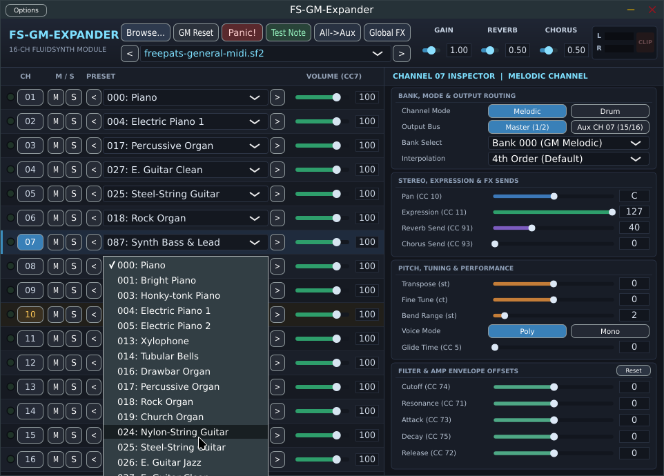
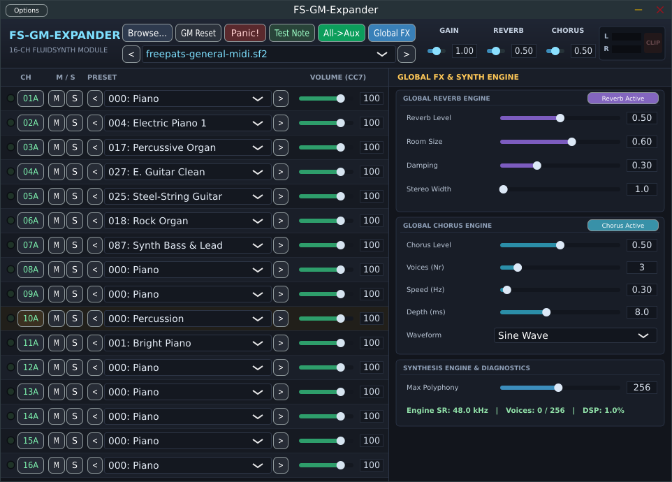

# FS-GM-Expander

**FS-GM-Expander** is a 16-channel multitimbral General MIDI SoundFont (`.sf2` / `.sf3`) synthesizer plugin (VST3 & Standalone) built with **JUCE** and **FluidSynth 2.x**.

Designed like a classic 19" hardware GM/GS sound module, it combines an immediate 16-channel rack overview on the left with a switchable **Channel Inspector** and **Global FX & Synth Engine** panel on the right.

## Screenshots

### 16-Channel Rack & Channel Inspector


### Global FX & Synthesis Engine (`All->Aux` Multi-Out Mode Active)


---

## Features

- **16 Multitimbral MIDI Channels**:
  - Per-channel MIDI activity LED, Mute (`M`), Solo (`S`), Bank/Preset selector (`<` / `>`), and Volume (`CC 7`) directly in the left rack.
  - Dedicated **Channel Inspector** for each channel (`CH 01`–`16`):
    - **Mode & Routing**: Switch between `Melodic` and `Drum` mode (Bank 128) on any channel; route individual channels either to `Master (Out 1/2)` or to their dedicated stereo `Aux CH 01–16` bus.
    - **Stereo, Expression & FX Sends**: Pan (`CC 10`), Expression (`CC 11`), Reverb Send (`CC 91`), Chorus Send (`CC 93`).
    - **Pitch & Performance**: Coarse Transpose (`-48..+48 st`), Fine Tune (`-99..+99 ct`), Pitch Bend Range (`0..24 st`), independent `Poly` / `Mono` voice mode, Portamento / Glide Time (`CC 5` / `CC 65`), and per-channel Resampling Interpolation (`None`, `Linear`, `4th Order`, `Sinc 11th`, `Sinc 17th`).
    - **Sound Shaping (Filter & Amp Envelope Offsets)**: Real-time SoundFont 2 generator offsets for Filter Cutoff (`CC 74`), Filter Resonance (`CC 71`), Attack (`CC 73`), Decay (`CC 75`), and Release (`CC 72`).
- **17 Stereo Output Buses (34 Audio Channels)**:
  - **Bus 0 (`Master`, Out 1/2)**: Carries all channels routed to Master plus the global Reverb and Chorus stereo returns.
  - **Buses 1–16 (`Aux CH 01` .. `Aux CH 16`, Out 3/4 .. 33/34)**: Individual dry stereo outputs for DAW multi-track mixing (e.g. in REAPER), with a one-click `All->Aux` routing toggle in the top bar.
- **Global FX & Synthesis Engine**:
  - Built-in FluidSynth Reverb (Room Size, Damping, Stereo Width, Level) and Chorus (Voices, Speed, Depth, Sine/Triangle Waveform, Level).
  - Adjustable max polyphony (`16`–`512` voices), automatic host sample-rate adaptation (proper resampling for 44.1 kHz SoundFonts in 48 kHz / 96 kHz DAW sessions), real-time voice counter, DSP load readout, and Master Stereo Peak Meter with clickable Clip indicator.
- **Workflow & Persistence**:
  - Remembers the last used SoundFont file and folder across sessions and provides a `<` [Folder SoundFont Dropdown] `>` switcher in the top bar.
  - Built-in `Test Note` audition button (plays a C-major triad on melodic channels or Kick/Snare/Hi-Hat on drum channels).
  - Full DAW state serialization (`getStateInformation` / `setStateInformation`) and GM/GS SysEx support.

---

## Requirements & Building (Linux)

### Dependencies
- **JUCE** (8.x)
- **FluidSynth** development libraries (`libfluidsynth-dev` / `fluidsynth`)
- Standard Linux audio/GUI build dependencies (`alsa`, `freetype2`, `fontconfig`, `x11`, `xext`, `xrandr`, `xinerama`, `xcursor`, `curl`, `webkit2gtk` / `gtk+-3.0` as configured in JUCE)

### Build Instructions

```bash
cd Builds/LinuxMakefile
make -j$(nproc)
```

For a release build with Link-Time Optimization (`-flto`):

```bash
cd Builds/LinuxMakefile
make CONFIG=Release -j$(nproc)
```

---

## Credits & Third-Party Libraries

All plugin source code in `Source/` was written specifically for **FS-GM-Expander**, building upon the following open-source libraries and SDKs:

- **[FluidSynth](https://www.fluidsynth.org/) ([GitHub](https://github.com/FluidSynth/fluidsynth))**  
  Real-time SoundFont 2/3 software synthesizer engine originally created by Peter Hanappe and maintained by Element Green, Tom Moebert, and the FluidSynth development team.  
  *License: GNU Lesser General Public License v2.1 or later (LGPL-2.1+).*

- **[JUCE Framework](https://juce.com/) ([GitHub](https://github.com/juce-framework/JUCE))**  
  Cross-platform C++ audio plugin and GUI framework by Raw Material Software Limited.  
  *License: GNU General Public License v3.0 (GPL-3.0) / JUCE Commercial License.*

- **[Steinberg VST3 Interface](https://www.steinberg.net/)**  
  VST is a registered trademark of Steinberg Media Technologies GmbH.

---

## License

Because this project uses the open-source edition of the **JUCE** framework alongside **FluidSynth** (LGPL-2.1+), it is distributed under the **GNU General Public License v3.0 (GPL-3.0)**.

---

## Author

**Hagen Barz** – [hagenbarz.de](https://hagenbarz.de)
